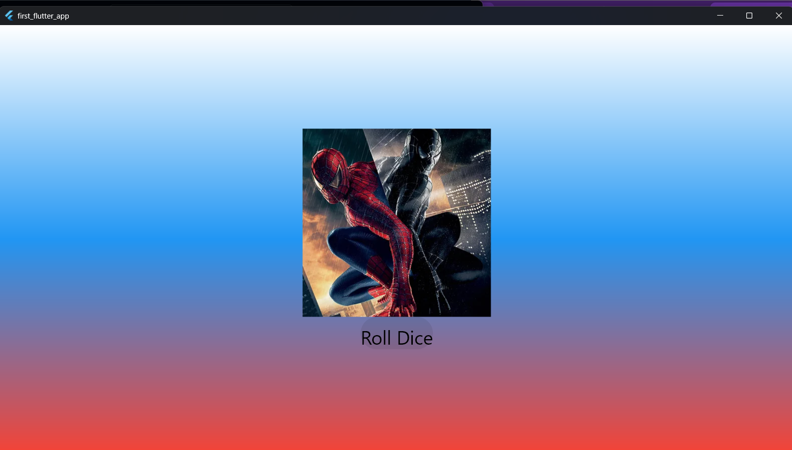

# Лабораторная работа №4-5. Flutter: структура UI и компонентный подход

Окишев Максим 
Группа: ИСП-242

### Что изучили?

> [!TIP]
> 1. Структуру UI
> 2. Компонентный подход
> 3. Создание собственных виджетов

### Скриншот финального приложения

### Запуск приложения

>[!NOTE]
>1. Клонировать репозиторий `git clone <url>`
>2. Перейти в папку проекта
>3. Выполнить `flutter pub get`
>4. Запустить командой `flutter run -d chrome`

### Ответы на вопросы

#### Зачем выносить виджеты в отдельные файлы?

Держать все виджеты в одном файле main.dart технически возможно — Flutter успешно скомпилирует и запустит такое приложение.

#### Что изменится, если держать всё в main.dart?

• «Ад из скобок» и потеря читаемости
• Падение производительности
• Смерть командной работы (конфликты при слиянии github)
• Сложность тестирования и поиска багов

#### Что такое BuildContext? Почему метод build() принимает его как параметр?

BuildContext — это объект, который содержит информацию о положении конкретного виджета в общем дереве виджетов приложения. Это его «адрес» и «паспорт».
Метод build(BuildContext context) принимает его как параметр, потому что виджету необходимо знать свое окружение, чтобы:

• Искать данные выше по дереву: например, узнавать текущую тему оформления (Theme.of(context)) или язык приложения.
• Управлять навигацией: открывать новые экраны (Navigator.of(context)), понимая, откуда именно происходит переход.
• Узнавать размеры: определять габариты экрана или свободное пространство через MediaQuery.
Без context виджет изолирован и не может взаимодействовать с остальной системой.

#### Почему Random() создаётся на уровне файла, а не внутри rollDice()?

Объект Random() создают на уровне файла (или класса), а не внутри функции rollDice(), по трем причинам:
• Производительность: Random() инициализируется один раз, а не создается заново при каждом броске кубика, экономя ресурсы процессора.
• Истинная случайность: Если вызывать функцию слишком часто (в одну миллисекунду), создание Random() внутри нее может выдать одинаковые числа из-за совпадающего системного времени (seed).
• Экономия памяти: Постоянное создание объекта внутри функции забивает оперативную память и нагружает сборщик мусора.
